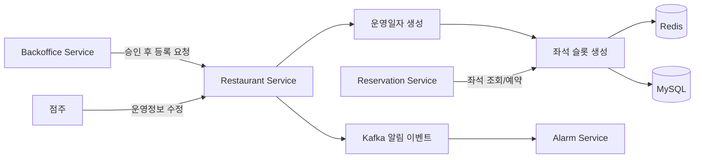
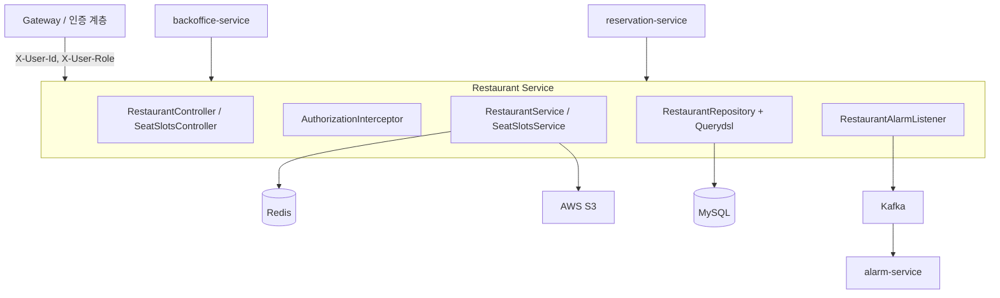

# Restaurant Service

DayeYAK 플랫폼의 음식점 등록, 운영일자 생성, 좌석 관리, 예약 가능 좌석 차감을 담당하는 레스토랑 서비스입니다.

기능 구현 자체보다 백오피스 승인 이후 음식점이 등록되는 흐름, 운영정보 입력 이후 좌석이 생성되는 구조, Redis 기반 좌석 동시성 제어, DB와 Redis 정합성 처리 과정을 중심으로 정리했습니다.

## 핵심 요약

- 백오피스 승인 신청서를 기반으로 음식점 기본 정보를 먼저 등록하고, 점주가 운영정보를 입력한 뒤 운영일자와 좌석을 생성하도록 분리했습니다.
- 운영일자와 좌석은 휴무일, 운영시간, 좌석 수가 모두 입력된 경우에만 생성되도록 검증했습니다.
- Redis Lua Script와 Redisson Lock으로 좌석 차감 과정의 동시성 문제를 제어하고 중복 예약 가능성을 줄였습니다.
- DB 트랜잭션 결과에 따라 Redis 값을 commit 이후 동기화하거나 rollback 시 복구하도록 설계했습니다.
- `afterCommit` 기반 Kafka 이벤트 발행으로 DB 상태와 알림 이벤트의 불일치 가능성을 줄였습니다.

## 프로젝트 소개

DayeYAK은 음식점, 공연, 전시 등 여러 서비스를 하나의 플랫폼에서 등록하고 예약할 수 있도록 구성한 MSA 기반 프로젝트입니다.

`restaurant-service`는 백오피스에서 승인된 음식점 신청서를 기반으로 음식점을 등록하고, 점주가 입력한 운영정보를 바탕으로 향후 30일의 운영일자와 시간대별 좌석을 생성합니다. 예약 서비스는 생성된 좌석 정보를 기준으로 예약 가능 좌석을 조회하고 차감합니다.



## 내가 담당한 영역

프로젝트 전체가 여러 도메인 서비스로 구성되어 있기 때문에, 제가 맡은 영역은 `음식점 등록 이후 예약 가능한 좌석 데이터가 안정적으로 생성되고 차감되는 흐름`입니다.

| 구분 | 내용 |
| --- | --- |
| 내가 구현/정리한 영역 | 음식점 CRUD, 운영정보 기반 운영일자/좌석 생성, 좌석 예약 동시성 제어, Redis-DB 정합성 처리, Kafka 발행 시점 정리, 이미지 업로드 수정 |
| 연동한 팀 서비스 | backoffice-service, reservation-service, alarm-service |
| 팀 전체 영역 | 백오피스 승인 처리, 실제 예약 주문 흐름, alarm-service의 Kafka consumer/SSE 알림 |

## 핵심 기술 포인트

- 운영정보 입력 여부에 따른 음식점 등록과 좌석 생성 책임 분리
- Redis Lua Script + Redisson Lock 기반 좌석 차감
- DB 트랜잭션 결과에 따른 Redis commit/rollback 동기화
- `afterCommit` 기반 Kafka 이벤트 발행
- Querydsl 기반 음식점 검색

## 기술 스택

- Java 17, Spring Boot 3.5.5
- Spring Web, Spring Data JPA, Querydsl
- MySQL
- Redis, Redisson, Lua Script
- Spring Kafka
- Spring Cloud OpenFeign, Eureka Client
- AWS S3

## 전체 아키텍처



## 음식점 등록과 좌석 생성 흐름 분리

### 왜 필요했나

백오피스에서 음식점 신청서를 승인하면 restaurant-service에는 음식점이 먼저 등록되어 있어야 합니다. 하지만 승인 시점의 신청서에는 점주가 실제 운영할 휴무일, 운영시간, 좌석 수가 아직 확정되지 않을 수 있습니다.

이 상태에서 운영일자와 좌석까지 강제로 생성하면 다음 문제가 생깁니다.

- 운영시간이 없는 좌석 슬롯 생성
- 좌석 수가 없는 예약 가능 좌석 생성
- 점주가 수정하기 전부터 잘못된 운영일자 데이터 생성

따라서 음식점 기본 정보 등록과 예약 가능한 좌석 생성 시점을 분리했습니다.

### 설계

음식점 생성 시에는 기본 정보만 등록할 수 있고, 운영정보가 모두 입력된 경우에만 운영일자와 좌석을 생성합니다.

```java
public void create(RestaurantRequestDto dto, S3Service s3Service) {
    setBasicInfo(dto, s3Service);
    if (hasOperatingInfo()) {
        validateOperatingInfo();
        generateOperatingDaysAndSeats(30);
    }
}
```

점주가 운영정보를 수정하면 해당 시점에 미래 30일 운영일자와 좌석을 다시 생성합니다.

```java
public void update(RestaurantRequestDto dto, S3Service s3Service) {
    boolean operatingInfoTouched = isOperatingInfoTouched(dto);
    updateBasicInfo(dto, s3Service);
    if (operatingInfoTouched) {
        validateOperatingInfo();
        regenerateOPAndSeats(30);
    }
}
```

### 적용 후

- 백오피스 승인 직후에도 음식점 기본 정보는 등록 가능
- 점주가 운영정보를 입력한 뒤에만 좌석 생성
- 운영시간, 휴무일, 좌석 수가 불완전한 상태의 좌석 데이터 생성 방지

## 운영일자와 좌석 생성 설계

### 왜 필요했나

예약 서비스가 좌석을 조회하려면 음식점별로 특정 날짜와 시간대에 대한 좌석 슬롯이 미리 생성되어 있어야 합니다. 동시에 너무 먼 미래의 좌석을 모두 생성하면 데이터가 불필요하게 늘어납니다.

### 설계

현재 날짜부터 30일 동안 운영일자를 만들고, 휴무일이 아닌 날짜에만 운영시간 기준으로 좌석 슬롯을 생성했습니다.

```java
public void generateOperatingDaysAndSeats(int daysAhead) {
    LocalDate today = LocalDate.now();
    for (int i = 0; i < daysAhead; i++) {
        LocalDate date = today.plusDays(i);
        upsertOperatingDayAndSeat(date);
    }
}
```

운영정보 수정 시에는 오늘 이후 운영일자와 좌석을 재생성하고, 과거 데이터는 유지합니다.

현재 구현은 운영정보 변경 시 오늘 이후 운영일자와 좌석을 재생성하는 구조입니다. 실제 운영 환경이라면 이미 예약된 슬롯에 대한 변경 제한 또는 예약 이관 정책이 추가로 필요합니다.

```java
public void regenerateOPAndSeats(int daysAhead) {
    LocalDate today = LocalDate.now();
    operatingDays.removeIf(o -> {
        if (!o.getDate().isBefore(today)) {
            if (o.getSeatSlots() != null) {
                o.getSeatSlots().clear();
            }
            return true;
        }
        return false;
    });

    generateOperatingDaysAndSeats(daysAhead);
}
```

### 적용 후

- 예약 가능한 30일 범위의 운영일자와 좌석을 자동 생성
- 휴무일에는 좌석 슬롯을 생성하지 않음
- 운영정보 변경 시 미래 예약 가능 데이터만 갱신

## Reservation Concurrency Control

### 왜 필요했나

동일한 좌석 슬롯에 예약 요청이 동시에 들어오면 DB 조회 시점의 잔여 좌석은 같아 보일 수 있습니다. 이 상태에서 여러 요청이 동시에 차감되면 잔여 좌석이 음수가 되거나, 실제 가능 좌석보다 많은 예약이 성공할 수 있습니다.

예약 좌석 차감은 사용자 응답과 바로 연결되므로 Kafka처럼 비동기 처리보다 즉시 성공/실패를 판단할 수 있는 구조가 필요했습니다.

### 설계

좌석 슬롯별로 Redisson Lock을 획득하고, Redis Lua Script로 잔여 좌석 확인과 차감을 한 번에 수행했습니다.

Lua Script는 좌석 차감 자체의 원자성을 보장하고, Redisson Lock은 Redis 차감 이후 DB 반영 및 트랜잭션 완료 시점까지 동일 슬롯에 대한 처리 흐름을 직렬화하기 위해 함께 사용했습니다.

```lua
local availableSeats = tonumber(redis.call('GET', KEYS[1]))
local requestedSeats = tonumber(ARGV[1])

if availableSeats == nil then
    return -1
end

if availableSeats >= requestedSeats then
    redis.call('DECRBY', KEYS[1], requestedSeats)
    return 1
else
    return 0
end
```

서비스에서는 Lua 결과가 성공일 때만 DB 좌석 수를 차감합니다.

```java
Number result = redissonClient.getScript().eval(
        RScript.Mode.READ_WRITE,
        luaScript,
        RScript.ReturnType.INTEGER,
        List.of(redisKey),
        count
);

if (result.intValue() == -1) {
    throw new BusinessException(ErrorCode.SEATS_NOT_FOUND);
} else if (result.intValue() == 0) {
    throw new BusinessException(ErrorCode.INSUFFICIENT_SEATS);
}

slot.setAvailableSeats(slot.getAvailableSeats() - count);
repository.saveAndFlush(slot);
```

### 적용 전

- 동시 요청 시 같은 잔여 좌석을 기준으로 중복 예약될 수 있음
- DB 차감과 예약 성공 응답 사이의 일관성 보장이 어려움

### 적용 후

- 동일 좌석 슬롯에 대한 차감을 Redis에서 원자적으로 처리
- 좌석 부족과 좌석 없음 상태를 즉시 구분
- 동시 요청 상황에서 중복 예약 가능성 감소

## Redis와 DB 정합성 설계

### 왜 필요했나

좌석 예약 흐름에서는 Redis가 먼저 차감되고, 이후 DB 좌석 수가 변경됩니다. 이때 DB 트랜잭션이 실패하면 Redis만 차감된 상태로 남을 수 있습니다.

반대로 DB는 성공했는데 Redis 복구 또는 초기화가 불완전하면 이후 예약 요청이 잘못된 잔여 좌석을 기준으로 처리될 수 있습니다.

Redis와 DB는 하나의 트랜잭션으로 묶이지 않기 때문에 완전한 원자성을 보장하는 구조는 아닙니다. 대신 트랜잭션 완료 시점에 commit/rollback 결과에 따라 Redis 값을 보정해 불일치 가능성을 줄이는 방식으로 설계했습니다.

본 구현에서는 DB를 최종 기준 데이터(Source of Truth)로 두고, Redis는 성능 향상과 동시성 제어를 위한 보조 저장소로 사용했습니다.

### 설계

예약 전 좌석 수와 예약 후 좌석 수를 모두 보관하고, 트랜잭션 완료 시점에 DB 결과에 맞춰 Redis를 동기화했습니다.

```java
private void registerRedisSyncAfterTransaction(
        RLock lock,
        String redisKey,
        Integer seatsBeforeReservation,
        Integer seatsAfterReservation
) {
    TransactionSynchronizationManager.registerSynchronization(new TransactionSynchronization() {
        @Override
        public void afterCompletion(int status) {
            try {
                Integer seatsToSync = status == STATUS_COMMITTED
                        ? seatsAfterReservation
                        : seatsBeforeReservation;
                redissonClient.getBucket(redisKey).set(seatsToSync);
            } finally {
                if (lock.isHeldByCurrentThread()) {
                    lock.unlock();
                }
            }
        }
    });
}
```

Redis에 좌석 키가 없으면 DB 값을 기준으로 초기화합니다.

```java
private void initializeRedisIfAbsent(String redisKey, Integer availableSeats) {
    if (redissonClient.getBucket(redisKey).get() == null) {
        redissonClient.getBucket(redisKey).set(availableSeats);
    }
}
```

애플리케이션 시작 시에도 DB의 전체 좌석 정보를 Redis에 적재합니다.

```java
@EventListener(ApplicationReadyEvent.class)
public void initRedis() {
    List<SeatSlots> slots = repository.findAll();
    for (SeatSlots slot : slots) {
        String key = "seatSlots:" + slot.getId();
        redissonClient.getBucket(key).set(slot.getAvailableSeats());
    }
}
```

### 적용 후

- DB commit 성공 시 Redis를 최종 좌석 수로 동기화
- DB rollback 시 Redis를 예약 전 좌석 수로 복구
- Redis 장애 또는 초기화 누락 시 DB 기준으로 좌석 캐시 재구성 가능
- 락 해제를 트랜잭션 완료 시점에 처리해 Redis 차감과 DB 반영 사이의 경쟁 가능성 감소

## Kafka 이벤트 발행 시점 설계

### 왜 필요했나

음식점 생성, 수정, 삭제 이후 alarm-service로 알림 이벤트를 보내야 했습니다. 하지만 DB 트랜잭션이 commit되기 전에 Kafka 이벤트를 발행하면, 롤백된 음식점 상태에 대한 알림이 먼저 전송될 수 있습니다.

### 설계

서비스에서는 도메인 이벤트를 발행하고, Kafka 전송은 `@TransactionalEventListener(phase = TransactionPhase.AFTER_COMMIT)`에서 처리했습니다.

`RestaurantAlarmListener`는 Kafka consumer가 아니라, 서비스 내부 도메인 이벤트를 받아 Kafka producer를 호출하는 Spring Event Listener입니다.

```java
private void registerEvent(Long restaurantId, Long userId, String restaurantName, Status status) {
    ServiceRegisterRequestDto dto = new ServiceRegisterRequestDto(
            userId,
            ServiceType.RESTAURANT,
            restaurantId,
            restaurantName,
            status
    );
    eventPublisher.publishEvent(new RestaurantAlarmEvent(this, topic, dto));
}
```

```java
@TransactionalEventListener(phase = TransactionPhase.AFTER_COMMIT)
public void handleRestaurantAlarm(RestaurantAlarmEvent event) {
    producerService.sendRegisterResult(event.getTopic(), null, event.getDto());
}
```

### 적용 후

- DB commit 이후에만 Kafka 이벤트 발행
- 롤백된 음식점 생성/수정/삭제 알림 방지
- 서비스 로직과 Kafka 전송 책임 분리

## Querydsl 동적 검색

음식점 목록은 사용자와 관리자가 이름, 지역, 음식점 유형을 조합해 조회할 수 있어야 했습니다. 각 조건은 서로 독립적으로 선택될 수 있기 때문에 조건 조합이 빠르게 증가하고, 이를 repository 메서드 조합으로 처리하면 검색 조건이 추가될 때마다 메서드와 분기가 늘어납니다.

이를 해결하기 위해 `RestaurantRepositoryImpl`에서 Querydsl `BooleanBuilder`를 사용해 이름, 지역, 음식점 유형, 소프트 삭제 조건을 동적으로 조합했습니다. 정렬은 `name`, `city`, `capacity` 기준으로 처리할 수 있도록 분리했습니다.

## 권한 검증 구조

레스토랑 서비스도 백오피스와 마찬가지로 Gateway에서 전달받은 `X-User-Id`, `X-User-Role`을 기반으로 권한을 검증합니다.

| 구성 요소 | 역할 |
| --- | --- |
| `@Authorize` | API별 action, resourceId, owner 검증 여부 선언 |
| `AuthorizationInterceptor` | 요청 헤더에서 사용자 정보를 추출하고 권한 검증 실행 |
| `PassportHolder` | Controller에서 인증 사용자 정보를 주입받기 위한 ArgumentResolver |
| `AccessCheckService` | 음식점 조회 후 sellerId 기반 소유권 검증 |
| `AccessGuard` | MASTER, SELLER, NORMAL 역할별 접근 정책 적용 |

점주는 본인 음식점만 수정할 수 있고, 일반 사용자는 조회 중심으로 제한됩니다.

## 이미지 업로드 흐름

음식점 생성은 백오피스 승인 이후 기본 정보 등록을 위해 사용되므로 이미지 파일을 받지 않습니다. 점주가 음식점 정보를 수정할 때만 `multipart/form-data`로 `requestDto`와 `imageFile`을 함께 전달하고, 이미지 파일이 있는 경우 S3에 업로드한 뒤 `imageUrl`을 갱신합니다.

## 트러블슈팅

### 운영정보 없는 음식점 생성 문제

백오피스 승인 직후에는 음식점이 등록되어야 하지만, 점주가 운영시간과 좌석 수를 입력하기 전일 수 있습니다. 이때 좌석 생성까지 강제하면 잘못된 좌석 데이터가 만들어질 수 있었습니다.

### 해결

- 음식점 기본 정보 생성과 좌석 생성 시점을 분리
- 운영정보가 하나라도 입력되면 `closedDay`, `openTime`, `closeTime`, `capacity`를 모두 검증
- 운영정보가 완성된 경우에만 30일 운영일자와 좌석 생성

---

### Redis 차감 후 DB 롤백 문제

좌석 예약에서 Redis Lua Script가 먼저 좌석을 차감한 뒤 DB 저장이 실패하면 Redis와 DB의 잔여 좌석이 달라질 수 있었습니다.

### 해결

- 예약 전 좌석 수와 예약 후 좌석 수를 함께 보관
- 트랜잭션 commit 시 Redis를 예약 후 좌석 수로 동기화
- 트랜잭션 rollback 시 Redis를 예약 전 좌석 수로 복구
- 락 해제는 `afterCompletion`에서 처리

---

### Kafka 알림 발행 시점 문제

음식점 생성/수정/삭제 이벤트를 트랜잭션 내부에서 바로 발행하면 DB 롤백 후에도 알림이 전송될 수 있었습니다.

### 해결

- 서비스는 `RestaurantAlarmEvent`만 발행
- Kafka 전송은 `@TransactionalEventListener(AFTER_COMMIT)`에서 처리
- DB 상태가 확정된 뒤에만 알림 이벤트 발행

## 성과 및 효과

- 백오피스 승인 이후 음식점 기본 등록과 점주 운영정보 입력 이후 좌석 생성을 분리해 실제 업무 흐름과 데이터 생성 시점을 일치시킴
- Redis Lua Script와 Redisson Lock으로 좌석 차감 과정의 동시성 문제를 제어해 중복 예약 가능성 감소
- DB 트랜잭션 결과에 맞춰 Redis 값을 commit/rollback 동기화해 잔여 좌석 정합성 개선
- Redis 초기화 전략을 추가해 애플리케이션 재시작 시 DB 기준 좌석 캐시 복구 가능
- Kafka 발행 시점을 commit 이후로 조정해 음식점 상태와 알림 이벤트의 불일치 가능성 감소

## 배운 점

- 예약처럼 즉시 성공/실패 판단이 필요한 기능은 비동기 이벤트보다 동시성 제어가 가능한 즉시 처리 구조가 더 적합할 수 있습니다.
- Redis를 빠른 저장소로 사용할 때도 최종 기준 데이터가 DB인지 Redis인지 명확히 정해야 합니다.
- 트랜잭션 내부에서 외부 시스템을 함께 다룰 때는 commit과 rollback 시나리오를 모두 설계해야 합니다.
- 백오피스 승인 데이터와 점주 운영 데이터처럼 입력 시점이 다른 데이터는 생성 책임을 분리하는 편이 안전합니다.

## 실행 방법

### 환경 변수

```env
DB_URL=jdbc:mysql://localhost:3306/restaurants
DB_USERNAME=root
DB_PASSWORD=password
SERVER_PORT=11200
KAFKA_BOOTSTRAP_SERVERS=localhost:9092
EUREKA_DEFAULT_ZONE=http://localhost:8761/eureka
REDIS_HOST=localhost
REDIS_PORT=6379
AWS_S3_BUCKET=
AWS_REGION=ap-northeast-2
AWS_ACCESS_KEY_ID=
AWS_SECRET_ACCESS_KEY=
```

### 테스트

```bash
./gradlew test
```

### 실행

```bash
./gradlew bootRun
```

## 주요 API

현재 경로는 실제 코드에 정의된 값을 그대로 표기했습니다.

| Method | Path | 설명 |
| --- | --- | --- |
| `GET` | `/restaurants` | 음식점 목록 검색 |
| `GET` | `/restaurants/{id}` | 음식점 단건 조회 |
| `POST` | `/restaurants` | 음식점 생성 |
| `PUT` | `/restaurants/{id}` | 음식점 수정 및 이미지 업로드 |
| `DELETE` | `/restaurants/{id}` | 음식점 삭제 |
| `POST` | `/restaurants/{id}/activation` | 음식점 활성화 상태 변경 |
| `POST` | `/restaurants/{id}/waiting` | 웨이팅 상태 변경 |
| `GET` | `/restaurantOpeningDates/{id}` | 음식점 운영일자 조회 |
| `GET` | `/seats/{restaurantId}/{operatingDayId}` | 좌석 슬롯 조회 |
| `POST` | `/seats/{restaurantId}/{operatingDayId}/{slotId}/reserve` | 좌석 예약 차감 |

## 참고

- 현재 restaurant-service는 좌석 예약 요청을 직접 받아 Redis와 DB 좌석 수를 함께 관리합니다.
- 백오피스 승인 프로세스 자체는 backoffice-service가 담당합니다.
- 알림 소비와 SSE 전송은 alarm-service에서 담당합니다.
- 실제 예약 주문 생성과 결제 흐름은 reservation/order 계열 서비스 영역입니다.
